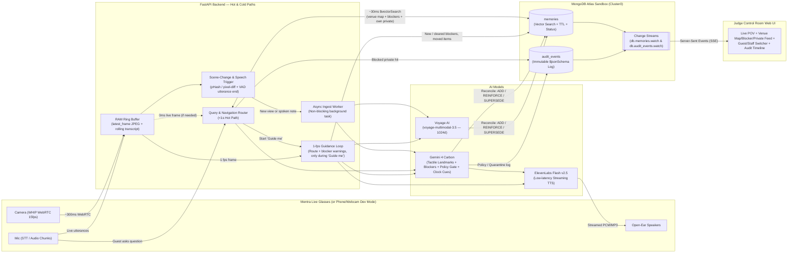

# 01 — System Architecture & Live Stream Pipeline

## High-Level Architecture



---

## How the Stream Feeds Into MongoDB Atlas (Step-by-Step)

A naive pipeline that uploads full MP4 videos, saves every frame, or waits for database indexing before answering will lag by 5–15 seconds. Instead, we separate **Hot RAM State** from **Filtered Async Indexing**:

### 1. Transport From Mentra Live (Critical SDK Detail)
- **Do NOT use Mentra's default `ingest: "srt"` / HLS** — HLS buffers segments and adds **10–20 seconds** of latency.
- **Primary path:** Use **WHIP / WebRTC** (`streamUrl: "http://<LAN_IP>:8889/mentra-live/whip"`, `video: { fps: 15 }`) or `warmUpCamera({ size: "medium", durationMs: 30_000 })` + fast `requestPhoto({ size: "medium", compress: "medium", sound: false })` bursts every ~2s.
- **Parallel Dev Fallback (Crucial for Team Speed):** Expose the exact same `/api/ingest/frame` and `/api/ingest/utterance` endpoints to a mobile/laptop browser `getUserMedia` page so all 3 teammates can build and test simultaneously while only 1 person wears the physical glasses.

### 2. Minimal-Footprint RAM Ring Buffer (Hot Path — Ready in `~0.4s`)
- As soon as WebRTC connects (`status: "streaming"`), an ffmpeg/aiortc decoder overwrites a **single in-memory variable**:
  ```python
  latest_frame: FrameSnapshot  # { jpeg_bytes, timestamp, phash, venue_id, user_id }  (venue_id = the venue the guest is in)
  recent_utterances: deque[Utterance]  # last 30s of spoken mic transcripts
  ```
- **Zero disk bloat:** Frames are *not* written to disk unless the Change Gate promotes one to a memory keyframe.
- **Instant Frame-1 Queries:** If the guest asks *"What's in front of me?"* **0.4 seconds** after starting the stream, the Query Router reads `latest_frame` straight from RAM (**0 ms capture wait**) and answers via Gemini 4 + ElevenLabs in **~1.1 seconds**.

### 3. The Change Gate (Prevents Flooding MongoDB)
Every `1.5 seconds`, a lightweight gate checks if anything meaningful happened:
1. **Visual change:** Perceptual hash (`pHash`) distance between `latest_frame` and `last_indexed_frame` exceeds threshold (i.e., the wearer turned their head, entered a new corridor or room, or something new is in the way, and the frame isn't motion-blurred).
2. **Spoken/overheard audio trigger:** Mic VAD finishes an utterance containing spatial, object, blocker or note content (e.g., *"Restrooms are past reception on the right"*, *"Wet floor outside the lift"*, *"Your room is the fourth door on the left"*, *"Room key in my left jacket pocket"*).

If **neither** changed (e.g., the guest is standing still in a quiet corridor), **nothing is sent to Gemini, Voyage, or MongoDB**.

### 4. Async Extraction, Multimodal Embedding & Policy Split (`~2–3s` in Background)
When the gate triggers, `asyncio.create_task(process_observation(...))` runs off the main thread:
1. **Gemini 4 Carbon (Single Structured JSON Call):**
   - Inputs: `latest_frame` JPEG (if visual) + `utterance_text` (if audio) + `venue_id`.
   - Outputs structured list of observations:
     - `item_key`: canonical normalized slug (`"elevator_bank"`, `"lobby_restroom"`, `"housekeeping_cart"`, `"room_key"`).
     - `category`: `"venue_fixture" | "blocker" | "personal_item" | "staff_note" | "spoken_note"` (`venue_fixture` = a fixed part of the venue, such as a door, stairs, an elevator or the reception desk; `blocker` = a temporary obstacle).
     - `tactile_anchor`: **strictly non-visual, touch/body-relative landmarks** (*"10 steps left of the main doors, call button at waist height"*, never *"next to the green sign"*).
     - `proposed_visibility`: `"public"` (shared with everyone in the venue; only fixtures & blockers with zero PII/faces) vs. `"private"` (the guest's belongings, meds, IDs, room key, private speech).
     - `ttl_seconds`: `null` (durable map entry), `7200` (blocker like a housekeeping cart or a freshly mopped floor), or the checkout time (room stay).
     - `bbox`: `[ymin, xmin, ymax, xmax]` (0–1000 normalized coordinates from Gemini for drawing highlights on the Judge UI!).
2. **Voyage Multimodal 3.5 (`voyage-multimodal-3.5`):**
   - Calls `voyageai.Client.multimodal_embed` with `[frame_image, summary_text + transcript]` (`model="voyage-multimodal-3.5"`, `input_type="document"`, `output_dimension=1024`).
   - Why this matters: even background items Gemini didn't explicitly itemize stay visually searchable in the 1024-d vector!
3. **MongoDB Reconciler & Audit Writer:**
   - Deduplicates or supersedes prior records for the same `(owner_id, item_key)` or `(venue_id, item_key)` and logs the policy decision to `audit_events` (see [`02-mongodb-schema-and-governance.md`](./02-mongodb-schema-and-governance.md)).

---

## End-to-End Latency Budget

| User Action | Path Taken | Target Latency to First Word |
| --- | --- | --- |
| *"Where's the elevator?"* / *"Where did I put my room key?"* | STT → `voyage-multimodal-3.5` query embed (`~90ms`) → Atlas `$vectorSearch` (`~30ms`) → Gemini 4 short answer (`~350ms`) → ElevenLabs Flash v2.5 (`~180ms`) | **~0.8 – 1.0 sec** |
| *"What's in front of me right now?"* | STT → grab `latest_frame` already in RAM (`0ms`) → Gemini 4 vision (`~650ms`) → ElevenLabs Flash v2.5 (`~180ms`) | **~1.1 – 1.3 sec** |
| *"Guide me to the restroom"* (guidance ticks) | 1-fps `latest_frame` → clock-face + obstacle check (`~450ms`) → cached/streamed short ElevenLabs cue (*"Keep left, 5 steps"*) | **Updates every ~1.0 sec** |
