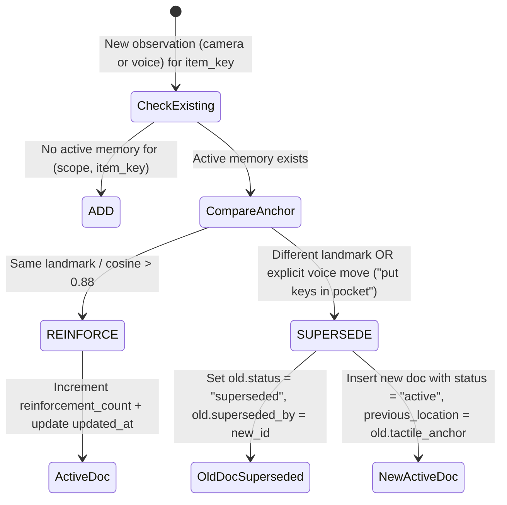

# 02 — MongoDB Atlas Storage, Schemas, Dedupe & Governance

The collections are created by [`db/setup.js`](../db/setup.js). Field names and values follow [`api-contract.md`](./api-contract.md): a stored document maps onto the contract's objects with only two changes, `_id` → `id` and BSON dates → ISO 8601 strings. Fields the contract does not have (`embedding`, `tactile_anchor`, ...) are backend-only and are left out of API responses.

## Why MongoDB Atlas Is Doing Real Work Here
Instead of treating MongoDB as a passive CRUD table, **four native Atlas capabilities** drive the entire agent lifecycle:
1. **Atlas Vector Search (`voyage-multimodal-3.5`, 1024-d) with Pre-Filtering:** Enforces the space's sharing rules (a user sees their own memories plus the groups their role can see) *inside* vector retrieval, so memories a caller may not see can never enter the LLM prompt.
2. **State Reconciliation (`active` → `superseded`):** Resolves contradictions across **camera sightings** and **voice transcripts** (e.g., camera saw keys on desk at 10:00 → voice says *"keys in hoodie pocket"* at 10:05).
3. **Native TTL Indexes (`expireAfterSeconds: 0`):** Permanently deletes expired and forgotten memories (a *freshly mopped floor* hazard after 2h, a whole temporary stay when it ends) a short time after they are marked, with no cron job.
4. **Change Streams (`watch()`) + Strict `$jsonSchema` Validation:** Streams memory and audit changes to the `GET /api/events` SSE feed while enforcing the shape of every record at the database engine level.

---

## Collections Overview (`hackathon` database on `Cluster0`)

| Collection | api-contract object | Notes |
| --- | --- | --- |
| `spaces` | `User` list + `Rules` | One document per `space_id`. |
| `memories` | `Memory` | Plus backend-only fields for retrieval and guidance. |
| `audit_events` | `AuditEntry` | Plus `query_text`. |
| `observations` | — | Backend-only trace of `POST /api/turn` and `POST /api/frames` calls. |

### 1. `spaces` — Members & Sharing Rules
One document per space; `_id` is the contract's `space_id`. `members` is the contract's `User` list for that space, and `rules` is the contract's `Rules` object, stored as is, so `GET /api/state` and `PUT /api/rules` read and write it directly.

```json
{
  "_id": "home",
  "name": "Home",
  "mode": "shared_space",
  "owner_id": "u_resident",
  "members": [
    { "id": "u_resident",  "name": "Resident",  "role": "resident" },
    { "id": "u_caregiver", "name": "Caregiver", "role": "caregiver" },
    { "id": "u_visitor",   "name": "Visitor",   "role": "visitor" }
  ],
  "rules": {
    "roles": {
      "resident":  { "can_see": ["*"] },
      "caregiver": { "can_see": ["care", "supplies", "house_guide"] },
      "visitor":   { "can_see": ["house_guide"] }
    },
    "topics": {
      "medication":  { "group": "care", "keep_for": "30d" },
      "supplies":    { "group": "supplies", "keep_for": null },
      "valuables":   { "group": "resident_only", "keep_for": null },
      "documents":   { "group": "resident_only", "keep_for": null },
      "house_guide": { "group": "house_guide", "keep_for": null },
      "hazard":      { "group": "house_guide", "keep_for": "2h" }
    },
    "default_group": "resident_only"
  },
  "default_expires_at": null
}
```
- `mode`, `owner_id` and `default_expires_at` are backend-only.
- `keep_for` must match `^[0-9]+[smhdw]$` or be `null`.
- A **temporary stay** (`mode: "temporary_stay"`: a guest room, hotel or respite stay) has no shared topics, so every memory falls into the owner-only `default_group`, and `default_expires_at` is the end of the stay:
  ```json
  {
    "_id": "stay_guest_room", "name": "Guest room", "mode": "temporary_stay", "owner_id": "u_resident",
    "members": [{ "id": "u_resident", "name": "Resident", "role": "resident" }],
    "rules": { "roles": { "resident": { "can_see": ["*"] } }, "topics": {}, "default_group": "resident_only" },
    "default_expires_at": "2026-11-15T11:00:00Z"
  }
  ```
- Index `members.id`: an unknown `user_id` returns 404 (contract clarification 6).

---

### 2. `memories` — Unified Multimodal & Voice Spatial Store
Stores every landmark, temporary hazard, personal object sighting, and spoken/overheard location note.

```json
{
  "_id": "m_01",
  "space_id": "home",
  "owner_id": "u_resident",
  "item": "house keys",
  "summary": "Keys are in the left jacket pocket.",
  "location": "left jacket pocket",
  "topic": "valuables",
  "group": "resident_only",
  "source": "voice",
  "status": "active",
  "superseded_by": null,
  "created_at": "2026-11-14T17:02:11Z",
  "updated_at": "2026-11-14T17:02:11Z",
  "expires_at": null,
  "image_url": null,

  "item_key": "house_keys",
  "policy_decision": {
    "topic": "valuables",
    "group": "resident_only",
    "reason": "Personal belonging + spoken personal ownership",
    "pii_redacted": false,
    "checked_at": "2026-11-14T17:02:11Z"
  },
  "reinforcement_count": 1,
  "tactile_anchor": "Left jacket pocket; the jacket hangs on the hook right of the front door.",
  "previous_location": "Waist-high wooden table, 6 inches right of the laptop charger.",
  "missing_since": null,
  "transcript_snippet": "I'm putting my keys in my left jacket pocket",
  "speaker": "self",
  "stt_confidence": 0.93,
  "source_observation_id": "obs_01J9Z8J2...",
  "bbox": null,
  "frame_thumb_b64": null,
  "embedding": [0.0184, -0.0412, "... 1024 floats from voyage-multimodal-3.5"],
  "purge_at": null
}
```

**Contract fields** (first block): exactly the contract's `Memory`.
- `source`: `camera | voice | both`. `status`: `active | superseded | forgotten | expired`.
- `group` is copied from the topic's group when the memory is stored, and is not changed when the rules change later (contract clarification 12). A memory with no matching topic gets topic `"other"` and the `default_group`.
- `expires_at` is when the memory becomes `expired`, from the topic's `keep_for` or the space's `default_expires_at`.
- `image_url` is the backend's own URL for `frame_thumb_b64`, never the glasses' signed URL.

**Backend-only fields** (second block):
- `item_key`: normalised slug the reconciler matches on (`"house_keys"`); `item` is the readable name.
- `tactile_anchor`: touch/body-relative guidance for the guide loop; `location` is the short version shown in the contract.
- `missing_since`: set by the guide loop when the user reaches the landmark and the item is not there. The memory stays `active`, because the contract has no `missing` status, until a newer sighting supersedes it.
- Voice fields (`null` for camera-only memories): `transcript_snippet` (max 2000 characters), `speaker` (`self` = the user, `other` = an overheard helper such as family, a carer or a co-worker, `unknown`), `stt_confidence` (0–1), `source_observation_id`.
- `purge_at`: when MongoDB deletes the document (TTL). See below.

#### Expiry, forgetting and deletion
The contract keeps expired and forgotten memories visible with their status, so the TTL index is on `purge_at`, not `expires_at`:
1. A backend sweep finds `status: "active"` memories with `expires_at` in the past, sets `status: "expired"`, `updated_at`, and `purge_at` (for example 1 hour later), and writes a `memory_expired` audit entry with `actor_id: "system"`.
2. "Forget my keys" sets `status: "forgotten"` and a short `purge_at` (for example 10 minutes), and writes `memory_forgotten`. Only the owner can forget a memory (clarification 11).
3. MongoDB deletes the document at `purge_at`. `null` means keep.

#### Key Indexes on `memories`
| Index | Used by |
| --- | --- |
| `{ purge_at: 1 }`, `expireAfterSeconds: 0` | TTL deletion |
| `{ space_id: 1, created_at: -1 }` | `GET /api/state` (newest first) |
| `{ space_id: 1, owner_id: 1, item_key: 1, status: 1 }` | Reconciler: an owner's active item |
| `{ space_id: 1, item_key: 1, group: 1, status: 1 }` | Reconciler: a shared item |
| `{ status: 1, expires_at: 1 }` | Expiry sweep |

**Atlas Vector Search Index (`memories_multimodal_vec`):**
```json
{
  "name": "memories_multimodal_vec",
  "type": "vectorSearch",
  "definition": {
    "fields": [
      { "type": "vector", "path": "embedding", "numDimensions": 1024, "similarity": "cosine" },
      { "type": "filter", "path": "space_id" },
      { "type": "filter", "path": "group" },
      { "type": "filter", "path": "owner_id" },
      { "type": "filter", "path": "status" }
    ]
  }
}
```

---

### 3. `audit_events` — Immutable Policy & Access Ledger (Track 1)
Exactly the contract's `AuditEntry`, plus the backend-only `query_text`. Every field except `query_text` is required.

```json
{
  "_id": "a_01",
  "ts": "2026-11-14T17:05:40Z",
  "space_id": "home",
  "actor_id": "u_visitor",
  "action": "query_denied",
  "verdict": "denied",
  "detail": "Asked about house keys. Group resident_only is not visible to role visitor.",
  "memory_ids": ["m_01"],
  "query_text": "Where are the house keys?"
}
```
- `action`: `memory_stored | memory_superseded | memory_forgotten | memory_expired | query_answered | query_denied | rule_changed`
- `verdict`: `allowed | denied | info`
- `actor_id`: a user id, `"dashboard"` for rule changes made there, or `"system"` for expiry (clarification 13).
- Policy Gate decisions are logged as `memory_stored`, with the topic, group and reason in `detail`.
- Indexes: `{ space_id: 1, ts: -1 }` (last 200 for `GET /api/state`), `{ actor_id: 1, ts: -1 }`.

---

### 4. `observations` — Short-Lived Raw Inputs (optional)
One row per `POST /api/turn` or `POST /api/frames` call the backend processed, kept until `expires_at` (TTL) so a memory can be traced back to what was seen or said. A turn looks like this:
```json
{
  "_id": "obs_01J9Z8J2...",
  "type": "turn",
  "space_id": "home",
  "user_id": "u_resident",
  "ts": "2026-11-14T17:02:10Z",
  "text": null,
  "heard_text": "I'm putting my keys in my left jacket pocket",
  "input_used": "audio",
  "kind": "saved",
  "memory_ids": ["m_01"],
  "audio_format": "wav",
  "sample_rate": 16000,
  "duration_ms": 2400,
  "speaker": "self",
  "stt_confidence": 0.93,
  "language": "en-CA",
  "audio_ref": null,
  "image_url": null,
  "gate_reason": "manual",
  "expires_at": "2026-11-15T17:02:10Z"
}
```
- `type`: `turn` (`POST /api/turn`) or `frame` (`POST /api/frames`).
- `text`, `heard_text`, `input_used`, `kind` and `memory_ids` are the turn's request and response fields. `audio_format` and `sample_rate` come from the request's `audio` object.
- `duration_ms` is capped at 25000 (the 25-second utterance limit).
- **Raw audio is never stored in MongoDB.** The validators on `observations` and `memories` reject any document with an `audio`, `audio_b64` or `data_b64` field. If short clips are ever kept, they go in GridFS with their own TTL, and only their id goes in `audio_ref`.
- Indexes: TTL on `expires_at`, and `{ space_id: 1, user_id: 1, ts: -1 }`.

---

## Zero-Leak Retrieval Query (One `$vectorSearch` Call)

When `caller_id` asks a question inside `space_id`, we embed the spoken question with `voyage-multimodal-3.5` (`input_type="query"`) and run **two fast checks**. The contract's rule: a user can see a memory if they own it, or their role's `can_see` contains the memory's `group` or `"*"`.

### Step A — Governed Retrieval (Only returns what `caller_id` is allowed to see)
The caller's role and `can_see` list are read from the `spaces` document, never from the request text:

```python
can_see = space["rules"]["roles"][caller_role]["can_see"]

visible = {} if "*" in can_see else {
    "$or": [
        {"owner_id": caller_id},
        {"group": {"$in": can_see}}
    ]
}

pipeline = [
    {
        "$vectorSearch": {
            "index": "memories_multimodal_vec",
            "path": "embedding",
            "queryVector": query_vec,
            "numCandidates": 60,
            "limit": 5,
            "filter": {"$and": [{"space_id": space_id}, {"status": "active"}, visible]}
        }
    },
    {"$project": {"embedding": 0, "score": {"$meta": "vectorSearchScore"}}}
]
```

### Step B — Auditable Denial Detection (For the Judge Demo!)
If Step A returns low-confidence/no match for an item request (e.g., the visitor asks *"Where are the house keys?"*), we check for an `active` memory matching that `item_key` in a group the caller's role cannot see — **never returning its location**. The backend writes a `query_denied` audit entry (`verdict: "denied"`, the matching ids in `memory_ids`) and replies with `kind: "denied"` and `memory_ids: []` (contract clarification 8). Judges see the red denied row pop up live in the Audit Log.

---

## Cross-Modal Reconciliation State Machine (`ADD` / `REINFORCE` / `SUPERSEDE`)

Every new observation (whether from **camera**, **voice**, or **both**) runs through `reconcile_memory(obs)`:



- Each `ADD` and `SUPERSEDE` writes a `memory_stored` or `memory_superseded` audit entry; the change stream turns these into `memory` and `audit` SSE events.
- **Why storing `previous_location` is magic for the user:** ElevenLabs can answer *"Your keys are in your left hoodie pocket — you moved them from the desk 8 minutes ago."*
