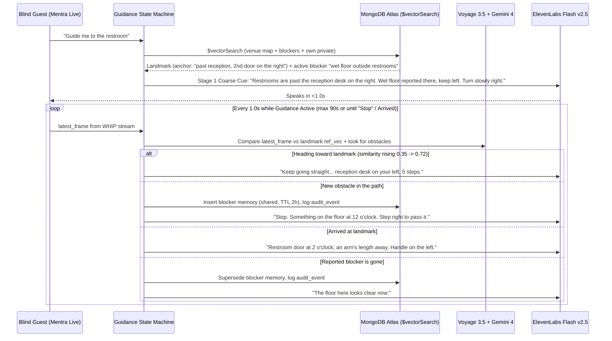

# 03 — Features in Detail & Continuous ElevenLabs Navigation

## Feature 1: Mapping the Venue (Camera + Microphone)
A blind guest cannot be expected to scan a building before using it, so the venue map is built by whoever walks it first (usually staff during setup, then topped up by every guest who passes through). Ingest handles **three input modes**:
1. **Silent Visual Sighting (Camera only):** Glasses pass the lobby and spot `elevator_bank` to the left of the main doors and `reception_desk` straight ahead → indexed via `voyage-multimodal-3.5` + a Gemini tactile anchor (*"10 steps left of the main doors, call button at waist height on the right of the doors"*).
2. **Pure Voice Notes (Mic only):**
   - Staff describing the venue: *"Restrooms are past the reception desk, second door on the right"*, *"Breakfast buffet starts at the wall opposite the windows; plates are at the left end."*
   - Overheard staff giving directions to the guest: *"Your room is the fourth door on the left after the elevator."*
   - A guest's own note: *"Room key in my left jacket pocket"*, *"Passport in the room safe, top shelf of the closet."*
   - Saved into the **same `memories` collection** (`source: "voice"`), embedded with `voyage-multimodal-3.5` (which embeds pure text into the same 1024-d vector space as images).
3. **Fused Observation (Camera + Voice together):** Staff look at a doorway while saying *"Careful, two steps down into the restaurant, handrail on the right"* → stores the visual doorway vector and the spoken step warning as one venue-map memory.

---

## Feature 2: Live Blocker Alerts
Blockers are anything temporary that gets in a guest's way: a wet floor, a housekeeping cart, a luggage trolley, chairs moved for an event, a closed corridor, a delivery in the service entrance.
- **Reported three ways:** spotted by any guest's or staff member's camera; said out loud (*"There's a cleaning cart blocking the corridor outside room 410"*); or added by staff from the dashboard.
- **Shared instantly:** blockers go to the venue's shared blocker layer and are pushed to every connected guest through Change Streams (`watch()`), so the warning arrives before the guest does.
- **Expire on their own:** each blocker gets a short `keep_for` (2 hours by default) and is removed by the TTL sweep, so stale warnings do not pile up. A camera that sees the corridor clear, or a staff note (*"the cart has gone"*), supersedes it straight away.
- **Used by "Guide me":** the guidance loop checks blockers along the route and warns or re-routes (*"Wet floor reported outside the restrooms 3 minutes ago. Keep to the left wall."*).

---

## Feature 3: Automatic Venue vs. Guest-Private Governance
Every incoming memory passes through a deterministic + LLM **Policy Gate** before it reaches MongoDB. "Shared" means *everyone in this venue*, not the world:

| Detected Observation | Layer | Why / Policy Rule |
| --- | --- | --- |
| Entrances, reception, elevators, stairs, ramps, restrooms, room doors, buffet, emergency exits | `🗺️ venue map` (shared) | Permanent layout, useful to every guest; stripped of faces, names and room occupants. |
| Wet floor, housekeeping cart, luggage trolley, event chairs, closed corridor | `⚠️ blocker` (shared, `TTL = 2h`) | Short-lived obstacle that every guest should hear about; expires on its own. |
| Room key, wallet, phone, bag, cane, glasses | `🔒 guest-private` (`owner_id`) | Personal property: locked to the guest, hidden from other guests **and** staff. |
| Passport, ID, booking papers, medication, bank cards | `🔒 guest-private` (`owner_id`) | Sensitive PII/health: quarantined; the frame thumbnail is omitted or blurred. |
| Maintenance notes, back-of-house routes, storage rooms | `🛎️ staff-only` | Operational detail staff need and guests do not. |
| Other guests' faces, names, room numbers on doors in use | **Not stored** | Redacted by the gate; never becomes a memory. |
| **Room stay (`mode: "temporary_stay"`)** | **All `🔒 private` + `TTL = checkout`** | A guest's own room: nothing is shared and every memory is wiped when the stay ends. |

The venue chooses which topics are shared and for how long (the space's Rules document); the gate enforces it.

---

## Feature 4: Voice Controls (*"Guide me"*, *"Forget"*, *"What's changed?"*, *"Check out"*)
Guests manage everything hands-free:
- **"Guide me to the elevator / my room / the breakfast room"** → step-by-step guidance (Feature 5), with blocker warnings on the way.
- **"What's around me?" / "What's on this floor?"** → reads nearby venue-map landmarks in clock-face terms (*"Elevators at 9 o'clock, 10 steps. Reception at 12 o'clock."*).
- **"Anything in my way?" / "What's changed since this morning?"** → lists active blockers and recent `superseded` changes in the venue (*"The luggage trolley by the elevator was moved 4 minutes ago; the corridor to the restaurant is still closed."*).
- **"Forget my passport" / "Clear everything from the last 5 minutes"** → deletes matching memories the guest owns and writes a `memory_forgotten` receipt to `audit_events`.
- **"I'm checking out"** → ends the room stay: every memory in it expires and is purged by TTL, and the checkout is logged.

---

## Feature 5: 2-Stage Step-by-Step Guidance Loop (ElevenLabs + Live Video)

When a guest asks *"Guide me to the restroom"* or *"Help me find my room key"*, a text answer is not enough — they need **calm, real-time physical guidance that adapts as they walk, turn and reach**, and that warns them about blockers before they reach them.

### Anti-Chatter Rules (Critical for Blind UX & Clean Stage Demos)
1. **Speak only on state transitions:** Store `last_spoken_bucket` (`TURN_RIGHT`, `STRAIGHT_AHEAD`, `OBSTACLE`, `ARRIVED`, `REACH_1_OCLOCK`) and enforce a **2.2-second minimum cooldown** between non-urgent cues so ElevenLabs never talks over itself. Obstacle warnings are urgent and skip the cooldown.
2. **Tactile + Clock-Face Language Only:** The system prompt bans visual-only words (*"blue", "the sign", "over there"*). Every cue uses **clock positions** (`10 o'clock`, `straight ahead at 12`), **step counts**, and **touchable references** (*"follow the wall on your left until the handrail"*).
3. **Instant Barge-In:** Any spoken `"stop"`, `"got it"`, or new question immediately cancels the active guidance loop and clears the audio queue.
