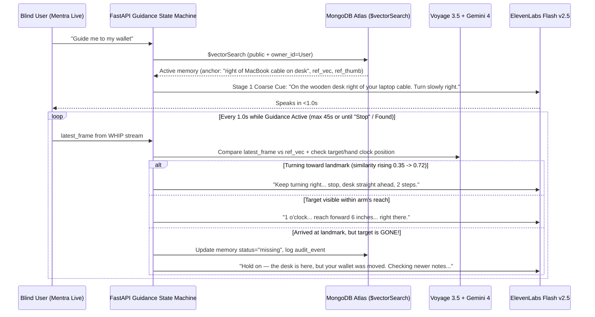

# 03 — Features in Detail & Continuous ElevenLabs Navigation

## Feature 1: Fused Camera + Microphone Memory
Cameras alone fail whenever an item goes out of line-of-sight (pockets, backpacks, closed drawers, hotel safes). Our ingest handles **three input modes seamlessly**:
1. **Silent Visual Sighting (Camera only):** Glasses pan past the table and spot `ibuprofen_bottle` left of the kettle → indexed via `voyage-multimodal-3.5` + Gemini tactile anchor.
2. **Pure Voice / Overheard Memory (Mic only):**
   - Self-note: *"Keys in my left jacket pocket"* or *"Passport in front backpack zipper."*
   - Overheard helper/clerk: *"Extra towels are in the bottom bathroom cabinet"* or *"Restroom code is 2580."*
   - Saved into the **exact same `memories` collection** (`source_modality: "voice"`), embedded with `voyage-multimodal-3.5` (which natively embeds pure text into the same 1024-d vector space as images!).
3. **Fused Multimodal Observation (Camera + Voice together):** User looks at a doorway while saying *"Careful, single step down right before the restroom door"* → stores both the visual doorway vector and spoken hazard warning in one `public` venue memory.

---

## Feature 2: Automatic Public ("Waze Indoors") vs. Private Governance
Every incoming memory passes through a deterministic + LLM **Policy Gate** before hitting MongoDB:

| Detected Observation | Visibility Assigned | Why / Policy Rule |
| --- | --- | --- |
| Exit signs, restroom doors, stairs, elevators, wall outlets, counters | `🟢 public` | Permanent venue geometry useful to all blind visitors; stripped of any bystander names/faces. |
| *"Wet floor by elevator"*, *"Chair blocking left aisle"* | `🟢 public` (`TTL = 2h`) | Shared hazard for other blind visitors, auto-expires in 2 hours. |
| Wallet, keys, phone, luggage, laptop, cane | `🔒 private` (`owner_id`) | Personal property — locked strictly to owner. |
| Prescriptions, IDs, mail, credit cards, pocket/bag voice notes | `🔒 private` (`owner_id`) | Sensitive PII/health — quarantined; raw frame thumbnail optionally omitted or blurred. |
| **Hotel Check-In Mode (`space_mode: "temporary_stay"`)** | **All `🔒 private` + `TTL = checkout`** | Inside a private hotel room, public sharing is auto-disabled and every memory self-destructs at checkout. |

---

## Feature 3: Voice Memory Controls (*"Forget"*, *"Check In"*, *"What Changed?"*)
Users manage governance completely hands-free by voice:
- **"Check into Room 412 until tomorrow 11 AM"** → Creates a scoped `spaces` entry; every scan in that space inherits `expires_at = tomorrow 11:00 AM` and `visibility = "private"`.
- **"Forget my prescriptions" / "Clear everything from the last 5 minutes"** → Soft/hard deletes matching `owner_id` records in `memories` and appends a `memory_forgotten_by_user` receipt to `audit_events`.
- **"What moved on this counter?"** → Queries recent `superseded` + `active` transitions in the current space (*"Your mug moved from left of the laptop to behind the monitor 4 minutes ago"*).

---

## Feature 4: 2-Stage Step-by-Step Navigation Loop (ElevenLabs + Live Video)

When a blind user asks *"Help me find my keys"* or *"Guide me to the water cooler"*, knowing the text answer isn't enough — they need **calm, real-time physical guidance that adapts as they turn and reach**.

### Anti-Chatter Rules (Critical for Blind UX & Clean Stage Demos)
1. **Speak only on state transitions:** Store `last_spoken_bucket` (`TURN_RIGHT`, `STRAIGHT_AHEAD`, `REACH_1_OCLOCK`, `FOUND`, `MISSING`) and enforce a **2.2-second minimum cooldown** between non-urgent cues so ElevenLabs never talks over itself.
2. **Tactile + Clock-Face Language Only:** System prompt bans visual-only words (*"blue", "shiny", "over there"*). Every cue uses **clock positions** (`10 o'clock`, `straight ahead at 12`), **step/inch estimates**, and **touchable reference objects** (*"feel the edge of the laptop, slide 4 inches right"*).
3. **Instant Barge-In:** Any spoken `"stop"`, `"got it"`, or new question immediately cancels the active guidance loop and clears the audio queue.
